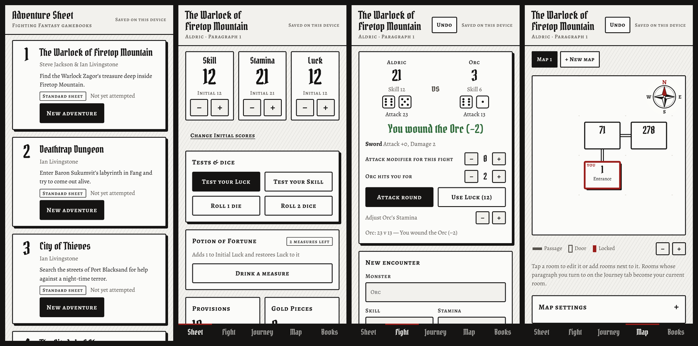

  <picture>
    <source media="(prefers-color-scheme: dark)" srcset="docs/logo-dark.png">
    
  </picture>

<b>▶ Play it now: <a href="https://adventuresheet.app">adventuresheet.app</a></b>

A free, phone-friendly adventure sheet for playing Fighting Fantasy gamebooks. Keep the book in your hands and your dice, scores, fights and maps on your phone.

## Put it on your phone

It works in any web browser, and you can add it to your home screen so it opens like an app and works with no signal.

**iPhone or iPad**
1. Open [adventuresheet.app](https://adventuresheet.app) in **Safari**.
2. Tap the **Share** button, then **Add to Home Screen**, then **Add**.
3. Open it once from the home screen while you're online. After that it works offline.

**Android**
1. Open [adventuresheet.app](https://adventuresheet.app) in **Chrome**.
2. Tap the **⋮** menu, then **Add to Home screen** (or **Install app**).

## What it does

- Pick your book from the shelf: books 1 to 10 of the current series are set up, and you can add others
- Roll Skill, Stamina and Luck with on-screen dice, plus Magic or Fear where a book uses them
- Fight monsters with automatic Attack Strength rolls, Luck in combat and escapes
- Test your Luck and Skill, drink potions, eat Provisions
- Inventory with weapons, armour, keys and treasure
- Spells for the books that use them
- Paragraph trail, notes and a dungeon mapper with a compass for each book
- Undo for mis-taps

## Your data

Everything is saved in the browser on the device you play on. There are no accounts and nothing is sent anywhere, so each person who uses the app has their own separate adventures.

Use **Books → Backup and restore** to copy your adventures to another device or keep a backup.

## Updating the app

1. Replace the changed files in this repository.
2. In `sw.js`, change `VERSION` to a new value (for example `'9'`) so phones pick up the update.
3. Commit and push. Phones get the new version the next time the app is opened once or twice.

## Credits

Fonts: Pirata One, Alegreya and Alegreya SC, used under the SIL Open Font License (see the `fonts` folder).

This is an unofficial fan-made tool. Fighting Fantasy is a trademark of Steve Jackson and Ian Livingstone. The app contains no text or artwork from the books; you'll need your own copy of each book to play.
